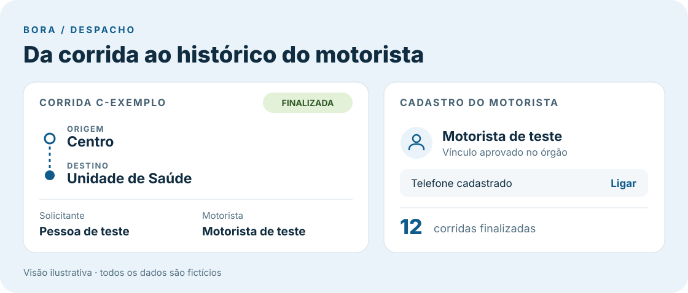
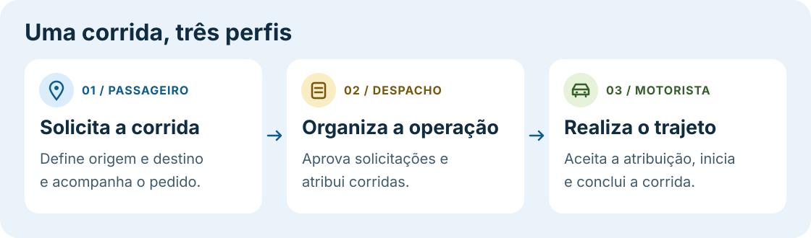
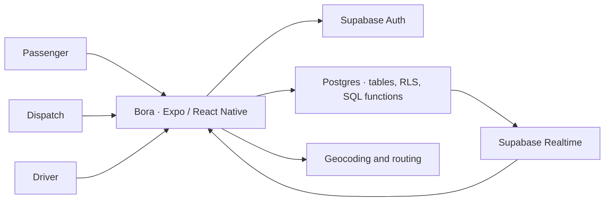

# Bora

[Português](README.md) · **English**

[](https://github.com/acamilateixeira/Bora/actions/workflows/ci.yml)

**A mobile ride management app built to meet a temporary need for the Municipal Government of Conceição do Mato Dentro, Minas Gerais, Brazil.** Bora records trips handled by contracted drivers and gives dispatch a view of who is eligible to work, who handled each ride, and where it went.

[The problem](#the-problem) · [Stack](#technology-stack) · [Architecture](#architecture) · [Technical decisions](#technical-decisions) · [Security and tests](#security-and-tests) · [Run the app](#run-the-app) · [Verify a ride](#verify-a-ride)

## The problem

The municipality had contracted drivers to handle trips, but its staff could not reliably answer basic questions about the operation. How many rides had each driver completed? Who requested each trip, where did it go, how could staff contact the driver, and whose engagement was still active?

The problem showed up **before a ride**, when dispatch needed to find and contact an eligible driver, and **after the ride**, when staff needed a record of what had been done. A driver's online status was also a different question from whether the department had approved them to take rides.

## What Bora delivered

| Operational question | How Bora answers it |
| --- | --- |
| **How many rides did each driver complete?** | The dispatch dashboard counts completed assignments by driver and department. The request history lets staff check individual rides. |
| **Who requested the ride and where did it go?** | A request records the requester, pickup, destination, and date. The assignment links the driver to the request, and status events record progress. |
| **How can staff contact a driver?** | Staff can search by name, phone number, or license plate and call the number on the driver's profile from the app. |
| **Who is eligible to take a ride?** | Dispatch can review approvals and blocks by department, alongside whether the driver is online, busy, or offline. |

Contract uncertainty drove the need to track eligibility. This repository records **the driver's operational membership in a department**. Legal contract terms, dates, and documents are verified through the municipality's administrative process.



*Illustration based on Bora's dispatch, ride, and driver screens, using fictional data.*

## One ride, three roles



| Role | In the app |
| --- | --- |
| **Passenger** | Sets the pickup and destination, requests a ride, and follows its status. |
| **Dispatch** | Manages requests, assigns rides, and monitors driver availability within the organization. |
| **Driver** | Sets availability, responds to assignments, and starts and completes rides. |

## Technology stack

| Technology | Role in Bora |
| --- | --- |
| **React Native, Expo SDK 54, and TypeScript** | Shared Android and iOS screens and components. |
| **Supabase Auth, Postgres, and Realtime** | Sign-in, persistence, row-level security (RLS), and change subscriptions. |
| **Expo Location and React Native Maps** | Location permissions, position updates, and route display. |
| **Photon, Nominatim, and OSRM** | Address lookup and route geometry. |
| **Expo Notifications and Edge Functions** | Device registration and optional push infrastructure. |

## Architecture



The app restores the session, reads the account's memberships, and opens the available role. Screens query Supabase and subscribe to changes in the tables relevant to each role.

## Technical decisions

| Decision | Rationale |
| --- | --- |
| **One app with three modes** | Authentication and common components live in a shared mobile codebase. Each role gets an interface for its own tasks. |
| **Supabase as the managed backend** | Auth, Postgres, and Realtime cover the workflow without a separate application server. Organization memberships and RLS enforce data access at the database layer. |
| **Membership separate from presence** | A driver can remain approved by a department while offline. Membership governs access, while presence helps dispatch decide who can take a ride now. |
| **Separate `requests` and `assignments`** | A request records what the passenger needs. An assignment records which driver received it and tracks that driver's progress. |
| **Realtime for status and assignments** | Passenger and dispatch screens can follow changes without a manual refresh. Delivery depends on the role's read policies and the tables enabled in the Realtime publication. |
| **Count from completed assignments** | The `org_top_drivers` view counts assignments with a `finished` status. Totals come from the ride workflow and can be checked against its history. |
| **Database RPC for driver availability** | `set_driver_status` updates current status and its history in one database operation. |

| Path | Responsibility |
| --- | --- |
| [`src/core/`](src/core) | Session, role selection, and app entry flow |
| [`src/screens/`](src/screens) | Sign-in, organization selection, and role-specific screens |
| [`src/services/`](src/services) | Organization, driver, and request operations |
| [`src/lib/`](src/lib) | Supabase client, driver presence, and notification registration |
| [`supabase/functions/`](supabase/functions) | Push and presence expiration Edge Functions |
| [`supabase_schema.sql`](supabase_schema.sql) | Database schema and access policies |
| [`supabase/migrations/`](supabase/migrations) | Database changes after the initial install |
| [`tests/`](tests) | Unit tests (`node:test`) and database tests (Postgres with Supabase stubs) |

## Security and tests

The app talks to Supabase directly with the public key, so every access rule lives in the database.

- **RLS on every operational table.** Policies scope rows to the user's organization or to the user. `security definer` helpers such as `is_org_member` and `has_role` centralize the check and pin `search_path`.
- **Push that doesn't trust the client.** The database calls the `notify` Edge Function with a secret stored in Supabase Vault. The function validates the payload, sends to Expo in batches of 100, and deletes tokens Expo reports as `DeviceNotRegistered`. Its logic lives in a dependency-free `handler.ts`, unit-tested without Deno or Supabase.
- **Presence expiry in the database.** `expire_stale_driver_status` marks drivers offline after 5 minutes without a signal, the same threshold the app uses, and only the service key can call it.

| Command | What it covers |
| --- | --- |
| `npm test` | Driver presence, formatting, addresses, and the `notify` handler (`node:test`, no install needed) |
| `npm run typecheck` | App TypeScript |
| `npm run test:db` | Applies schema, triggers, and migrations to a fresh disposable Postgres 16 database (`DATABASE_URL`) with stubs for `auth`, Vault, and `pg_net`, then tests cross-tenant RLS, `set_driver_status`, presence expiry, and push |

[CI](.github/workflows/ci.yml) runs all of them plus `deno check` on the Edge Functions for every PR. PRs also get title/description checks and an automated AI review.

## Run the app

Use Node.js 22, npm, and a development Supabase project. Open the app on a device with Expo Go compatible with SDK 54, an Android emulator, or an iOS simulator. [Expo Go compatibility](https://docs.expo.dev/troubleshooting/expo-go-version-mismatch/)

### 1. Clone the repository

Use a GitHub account with access:

```bash
git clone https://github.com/acamilateixeira/Bora.git
cd Bora
```

### 2. Install dependencies and configure Supabase

```bash
npm ci
cp -n .env.example .env
```

Set the Supabase URL and **publishable** or **anon** key in `.env`. The `EXPO_PUBLIC_*` variables are bundled with the app. Keep the service key on the backend.

For a fresh database, apply [`supabase_schema.sql`](supabase_schema.sql) in the development project's SQL Editor, followed by [`supabase_push.sql`](supabase_push.sql) and the files in [`supabase/migrations/`](supabase/migrations) in order. Create and confirm the four accounts below in Supabase Auth, set development passwords, and run [`supabase_seed.sql`](supabase_seed.sql). Enable the relevant Realtime tables using the [Supabase setup guide in Portuguese](docs/supabase.md#realtime).

| Test account | Role |
| --- | --- |
| `rider@bora.local` | Passenger |
| `driver@bora.local` | Driver |
| `dispatcher@bora.local` | Dispatch |
| `admin@bora.local` | Administrator |

### 3. Open on a phone or simulator

```bash
npm start
```

Scan the QR code or press `a` for Android or `i` for iOS with the corresponding environment installed. Run `npm run typecheck` in a separate terminal to check TypeScript.

## Verify a ride

1. Sign in as a passenger. Select **Secretaria de Educacao**, the seeded organization, and request a ride with a new pickup and destination.
2. Sign in as dispatch in the same organization. Approve the request and assign the test driver.
3. Sign in as the driver. Accept the assignment and start the ride. Enter the passenger's PIN when prompted.
4. Complete the ride. In dispatch, check the completed request, requester, route, and driver total. Open **Motoristas** (Drivers) to find the profile and its test phone number.

The [Supabase setup guide in Portuguese](docs/supabase.md) also documents optional push notifications and the presence expiration function.

## Postman, Insomnia, and verification

Import the [Bora collection](docs/postman.collection.json) into Postman or Insomnia. Set `baseUrl`, `supabaseKey`, `demoEmail`, `demoPassword`, and `otherOrgId` using a development project and a demo account with no membership in the other organization. The collection signs in and reads trip records. Use the app walkthrough for the dispatch flow and `npm run test:db` for the RLS suite.
