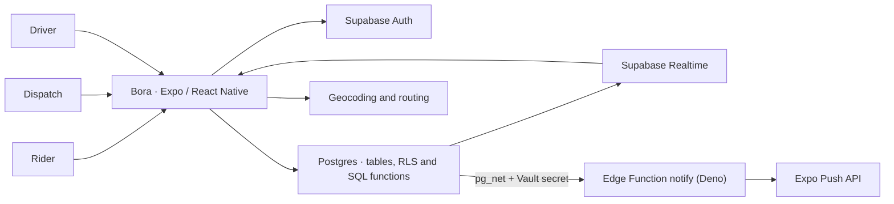

# Bora

**Mobile ride-management app for organizations.** People who need to travel request a ride, a dispatch team handles it, and a driver completes the trip. Each role gets its own interface in the same app.

`React Native 0.81` · `Expo SDK 54` · `TypeScript` · `Supabase` (Postgres, RLS, Realtime, Edge Functions)

[](https://github.com/acamilateixeira/bora/actions/workflows/ci.yml)

[Português](README.md) · [Supabase guide (PT)](docs/supabase.md)

## One ride, three roles

| Role | What they do in the app |
| --- | --- |
| **Rider** | Sets pickup and destination, requests a ride, and follows its status. |
| **Dispatch** | Manages requests, assigns rides, and tracks driver availability across the organization. |
| **Driver** | Sets availability, responds to assignments, and starts and finishes rides. |

## Architecture



- **Multi-tenant by organization.** Supabase Auth identifies the account; memberships in the database decide which organizations and roles are available. Row-level security policies on every operational table scope reads and writes to the user's organization or to the user.
- **Requests and assignments are separate.** A request records pickup, destination, and status. An assignment links a driver to the request and tracks that job.
- **Real-time updates.** Screens subscribe to Postgres changes through Supabase Realtime, which also enforces RLS. Drivers share device location; the rider screen uses geocoding and routing services.
- **State changes go through SQL functions.** `set_driver_status` checks `auth.uid()`, validates the driver's membership, and keeps an availability history in one transaction.

## Security and tests

The app talks to Supabase directly with the public key, so every access rule lives in the database.

- `security definer` helpers (`is_org_member`, `has_role`, …) centralize the tenant checks and pin `search_path`.
- Push notifications don't trust the client: the database calls the `notify` Edge Function with a secret stored in Supabase Vault. The function validates the payload, sends to Expo in batches of 100, and deletes tokens Expo reports as `DeviceNotRegistered`. Its logic lives in a dependency-free `handler.ts`, so it's unit-tested without Deno or Supabase.
- `expire_stale_driver_status` marks drivers offline after 5 minutes without a signal, matching what the app already shows, and can only be called with the service key.

| Command | What it covers |
| --- | --- |
| `npm test` | Driver presence, formatting, addresses, and the `notify` handler (`node:test`, no install needed) |
| `npm run typecheck` | App TypeScript |
| `npm run test:db` | Applies schema, triggers and migrations to plain Postgres 16 with stubs for `auth`, Vault and `pg_net`, then tests cross-tenant RLS, `set_driver_status`, presence expiry, and push |

[CI](.github/workflows/ci.yml) runs all of them plus `deno check` on the Edge Functions for every PR. PRs also get title/description checks and an automated AI review.

## Run the app

Use Node.js 22, npm, and a development Supabase project. Open the app on a device with Expo Go for SDK 54, an Android emulator, or an iOS simulator.

```bash
npm ci
cp -n .env.example .env   # Supabase URL + publishable/anon key
npm start
```

To start from an empty database, follow the [Supabase guide](docs/supabase.md): apply the schema, the push triggers and the migrations, create the test accounts, and enable Realtime.

## Try a ride

1. Sign in as the rider, pick **Secretaria de Educacao**, and request a ride.
2. Sign in as dispatch in the same organization. Approve the request and assign it to the test driver.
3. Sign in as the driver. Accept the assignment and start the ride, confirming with the rider's PIN.
4. Finish the ride and check the status on the rider and dispatch screens.
