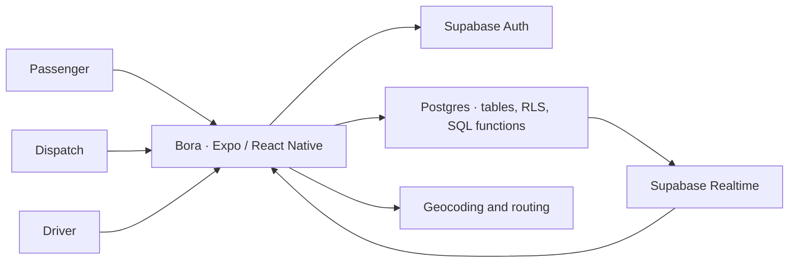

# Bora

[Português](README.md) · **English**

**A mobile ride management app built to meet a temporary need for the Municipal Government of Conceição do Mato Dentro, Minas Gerais, Brazil.** Bora brings ride requests, dispatch, and trip execution into one app, with a dedicated interface for each role.

[Stack](#technology-stack) · [Architecture](#architecture) · [Technical decisions](#technical-decisions) · [Run the app](#run-the-app) · [Verify a ride](#verify-a-ride)

## One ride, three roles


| Role | In the app |
| --- | --- |
| **Passenger** | Sets the pickup and destination, requests a ride, and follows its status. |
| **Dispatch** | Manages requests, assigns rides, and monitors driver availability within the organization. |
| **Driver** | Sets availability, responds to assignments, and starts and completes rides. |

## Technology stack

| Technology | Role in Bora |
| --- | --- |
| **React Native, Expo SDK 54, and TypeScript** | Shared Android and iOS screens and components. |
| **Supabase Auth, Postgres, and Realtime** | Sign-in, persistence, row-level security (RLS), and change subscriptions. |
| **Expo Location and React Native Maps** | Location permissions, position updates, and route display. |
| **Photon, Nominatim, and OSRM** | Address lookup and route geometry. |
| **Expo Notifications and Edge Functions** | Device registration and optional push infrastructure. |

## Architecture



The app restores the session, reads the account's memberships, and opens the available role. Screens query Supabase and subscribe to changes in the tables relevant to each role.

## Technical decisions

| Decision | Rationale |
| --- | --- |
| **One app with three modes** | Authentication and common components live in a shared mobile codebase. Each role gets an interface for its own tasks. |
| **Supabase as the managed backend** | Auth, Postgres, and Realtime cover the workflow without a separate application server. Organization memberships and RLS enforce data access at the database layer. |
| **Separate `requests` and `assignments`** | A request records what the passenger needs. An assignment records which driver received it and tracks that driver's progress. |
| **Realtime for status and assignments** | Passenger and dispatch screens can follow changes without a manual refresh. Delivery depends on the role's read policies and the tables enabled in the Realtime publication. |
| **Database RPC for driver availability** | `set_driver_status` updates current status and its history in one database operation. |

| Path | Responsibility |
| --- | --- |
| [`src/core/`](src/core) | Session, role selection, and app entry flow |
| [`src/screens/`](src/screens) | Sign-in, organization selection, and role-specific screens |
| [`src/services/`](src/services) | Organization, driver, and request operations |
| [`src/lib/`](src/lib) | Supabase client, driver presence, and notification registration |
| [`supabase/functions/`](supabase/functions) | Push and presence expiration Edge Functions |
| [`supabase_schema.sql`](supabase_schema.sql) | Database schema and access policies |

## Run the app

Use Node.js 22, npm, and a development Supabase project. Open the app on a device with Expo Go compatible with SDK 54, an Android emulator, or an iOS simulator. [Expo Go compatibility](https://docs.expo.dev/troubleshooting/expo-go-version-mismatch/)

```bash
npm ci
cp -n .env.example .env
```

Set the Supabase URL and **publishable** or **anon** key in `.env`. The `EXPO_PUBLIC_*` variables are bundled with the app. Keep the service key on the backend.

For a fresh database, apply [`supabase_schema.sql`](supabase_schema.sql) in the development project's SQL Editor. Create and confirm the four accounts below in Supabase Auth, set development passwords, and run [`supabase_seed.sql`](supabase_seed.sql). Enable the relevant Realtime tables using the [Supabase setup guide in Portuguese](docs/supabase.md#realtime).

| Test account | Role |
| --- | --- |
| `rider@bora.local` | Passenger |
| `driver@bora.local` | Driver |
| `dispatcher@bora.local` | Dispatch |
| `admin@bora.local` | Administrator |

```bash
npm start
npx tsc --noEmit
```

Scan the QR code or press `a` for Android or `i` for iOS with the corresponding environment installed. Run the TypeScript check in a separate terminal.

## Verify a ride

1. Sign in as a passenger. Select **Secretaria de Educacao**, the seeded organization, and request a ride with a new pickup and destination.
2. Sign in as dispatch in the same organization. Approve the request and assign the test driver.
3. Sign in as the driver. Accept the assignment and start the ride. Enter the passenger's PIN when prompted.
4. Complete the ride and check its status as both passenger and dispatch.

The [Supabase setup guide in Portuguese](docs/supabase.md) also documents optional push notifications and the presence expiration function.
