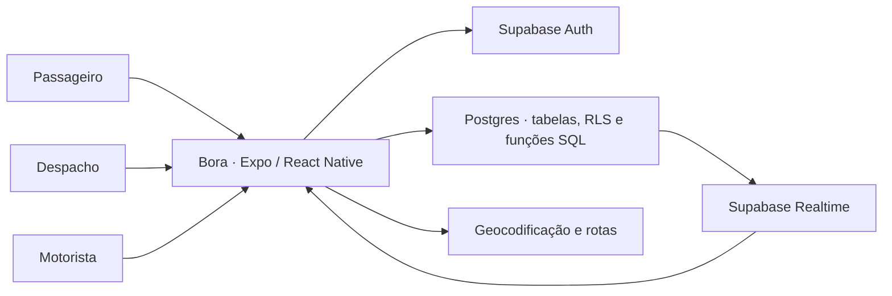

# Bora

**Português** · [English](README.en.md)

**App mobile de gestão de corridas criado para atender uma necessidade temporária da Prefeitura de Conceição do Mato Dentro, em Minas Gerais.** O Bora registra o trabalho dos motoristas contratados e dá à equipe de despacho uma visão de quem está apto a atender, quem fez cada corrida e para onde ela foi.

`React Native 0.81` · `Expo SDK 54` · `TypeScript` · `Supabase`

[O problema](#o-problema) · [Rodar o app](#rodar-o-app) · [Arquitetura](#arquitetura) · [Decisões técnicas](#decisões-técnicas) · [Validar uma corrida](#validar-uma-corrida) · [Guia do Supabase](docs/supabase.md)

## O problema

A prefeitura tinha motoristas contratados para atender deslocamentos, mas a equipe não conseguia responder com segurança a perguntas básicas da operação. Quantas corridas cada motorista já tinha feito? Quem havia solicitado cada uma, para onde a pessoa foi, como contatar o motorista e quem ainda tinha vínculo ativo para receber novas corridas?

A dificuldade aparecia tanto **antes da corrida**, ao decidir quem podia atender e como localizar essa pessoa, quanto **depois**, ao reconstruir o que foi atendido. Saber que um motorista estava online também era diferente de saber se ele estava autorizado a trabalhar naquele órgão.

## O que o Bora entregou

| Pergunta da operação | Resposta no Bora |
| --- | --- |
| **Quantas corridas cada motorista fez?** | O painel de despacho conta atribuições finalizadas por motorista e por órgão. O histórico de solicitações permite conferir os atendimentos. |
| **Para quem e para onde?** | Cada solicitação guarda o solicitante, a origem, o destino e a data. A atribuição liga o motorista ao pedido e as mudanças de status registram o andamento. |
| **Como falar com o motorista?** | O cadastro permite buscar por nome, telefone ou placa e ligar pelo app a partir do número registrado. |
| **Quem pode receber uma corrida?** | O despacho acompanha aprovações e bloqueios por órgão, enquanto a disponibilidade informa se o motorista está online, ocupado ou offline. |

A dúvida sobre contrato motivou o controle de quem podia atender. A versão deste repositório registra **o vínculo operacional do motorista com o órgão**. A vigência jurídica e os documentos do contrato são verificados no processo administrativo da prefeitura.


*Ilustração com dados fictícios baseada nas telas de despacho, corridas e motoristas do Bora.*

## Uma corrida, três perfis


| Perfil | O que faz no app |
| --- | --- |
| **Passageiro** | Define origem e destino, solicita uma corrida e acompanha seu status. |
| **Despacho** | Gerencia solicitações, atribui corridas e acompanha a disponibilidade de motoristas na organização. |
| **Motorista** | Ajusta sua disponibilidade, responde a atribuições e inicia e finaliza corridas. |

## Tecnologias

| Tecnologia | Papel no Bora |
| --- | --- |
| **React Native, Expo SDK 54 e TypeScript** | App para Android e iOS, com telas e componentes compartilhados. |
| **Supabase Auth, Postgres e Realtime** | Login, persistência, políticas de acesso por linha (RLS) e assinaturas de alterações. |
| **Expo Location e React Native Maps** | Permissões de localização, coleta de posição e visualização do trajeto no mapa. |
| **Photon, Nominatim e OSRM** | Busca de endereços e cálculo do traçado entre origem e destino. |
| **Expo Notifications e Edge Functions** | Registro de dispositivos e infraestrutura de push opcional. |

## Arquitetura



O app restaura a sessão, identifica os vínculos da conta e abre o modo disponível. As telas consultam o Supabase e assinam mudanças nas tabelas relevantes para cada perfil.

## Decisões técnicas

| Decisão | Por que importa |
| --- | --- |
| **Um app com três modos** | Reúne autenticação e componentes comuns em uma base mobile. Cada perfil ganha uma interface voltada às suas tarefas. |
| **Supabase como backend gerenciado** | Auth, Postgres e Realtime cobrem o fluxo sem exigir um servidor de aplicação próprio. Os vínculos por órgão e as políticas RLS levam as regras de acesso para o banco. |
| **Vínculo separado de presença** | Um motorista pode continuar aprovado pelo órgão mesmo quando está offline. O vínculo regula o acesso e a presença ajuda o despacho a decidir quem pode atender naquele momento. |
| **Separar `requests` de `assignments`** | O pedido preserva a intenção do passageiro, enquanto a atribuição registra qual motorista recebeu a corrida e o andamento daquele atendimento. |
| **Realtime para status e atribuições** | Passageiro e despacho podem acompanhar mudanças sem recarregar manualmente. A entrega depende das permissões de leitura e das tabelas habilitadas na publicação Realtime. |
| **Contagem a partir de corridas finalizadas** | A view `org_top_drivers` agrega as atribuições com status `finished`. A contagem vem do próprio fluxo de corrida e pode ser conferida no histórico. |
| **RPC para disponibilidade do motorista** | `set_driver_status` mantém o status atual e seu histórico na mesma operação no banco, em vez de espalhar essas escritas pelas telas. |

| Caminho | Responsabilidade |
| --- | --- |
| [`src/core/`](src/core) | Sessão, seleção de modo e navegação principal |
| [`src/screens/`](src/screens) | Autenticação, organização e interfaces dos três perfis |
| [`src/services/`](src/services) | Operações de organizações, motoristas e solicitações |
| [`src/lib/`](src/lib) | Cliente Supabase, presença e registro de notificações |
| [`supabase/functions/`](supabase/functions) | Edge Functions de push e expiração de presença |
| [`supabase_schema.sql`](supabase_schema.sql) | Estrutura do banco e políticas de acesso |

## Rodar o app

Use Node.js 22, npm e um projeto Supabase de desenvolvimento. Para abrir o app, use um dispositivo com Expo Go compatível com o SDK 54, um emulador Android ou um simulador iOS. [Compatibilidade do Expo Go](https://docs.expo.dev/troubleshooting/expo-go-version-mismatch/)

### 1. Prepare o projeto

No terminal, clone o repositório com uma conta GitHub que tenha acesso:

```bash
git clone https://github.com/acamilateixeira/Bora.git
cd Bora
```

### 2. Instale e configure o Supabase

```bash
npm ci
cp -n .env.example .env
```

Preencha o `.env` com a URL e a chave **publishable** ou **anon** do projeto Supabase. Variáveis `EXPO_PUBLIC_*` entram no bundle do app. Guarde a chave de serviço apenas no backend.

Para começar com um banco vazio, siga o [guia do Supabase](docs/supabase.md) para aplicar o schema, criar contas de teste e habilitar o Realtime.

### 3. Abra no celular ou simulador

```bash
npm start
```

Leia o QR code ou pressione `a` para Android ou `i` para iOS com o ambiente correspondente instalado. Para checar o TypeScript, execute `npx tsc --noEmit`.

## Validar uma corrida

1. Entre como passageiro, selecione **Secretaria de Educacao** no ambiente de teste e solicite uma corrida com uma origem e um destino novos.
2. Entre como operador de despacho na mesma organização. Aprove a solicitação e atribua a corrida ao motorista de teste.
3. Entre como motorista. Aceite a atribuição e inicie a corrida. Use o PIN exibido para o passageiro quando o app solicitar a confirmação.
4. Finalize a corrida. No despacho, confira a solicitação finalizada, o solicitante, o trajeto e a contagem do motorista. Na aba **Motoristas**, localize o cadastro e confira o telefone de teste.

O [guia do Supabase](docs/supabase.md) lista as contas fictícias e as dependências para testar Realtime e notificações separadamente.
