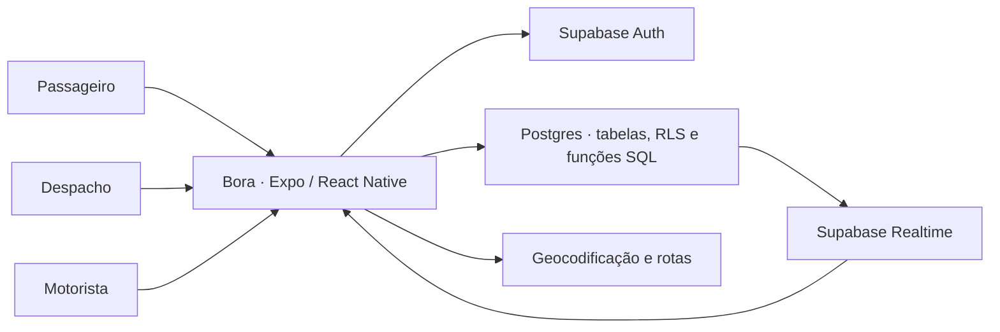

# Bora

**App mobile de gestão de corridas para organizações.** Quem precisa se deslocar solicita a corrida, a equipe de despacho organiza o atendimento e o motorista executa o trajeto. Cada perfil tem sua própria interface no mesmo app.

`React Native 0.81` · `Expo SDK 54` · `TypeScript` · `Supabase`

[Rodar o app](#rodar-o-app) · [Arquitetura](#arquitetura) · [Validar uma corrida](#validar-uma-corrida) · [Guia do Supabase](docs/supabase.md)

## Uma corrida, três perfis


| Perfil | O que faz no app |
| --- | --- |
| **Passageiro** | Define origem e destino, solicita uma corrida e acompanha seu status. |
| **Despacho** | Gerencia solicitações, atribui corridas e acompanha a disponibilidade de motoristas na organização. |
| **Motorista** | Ajusta sua disponibilidade, responde a atribuições e inicia e finaliza corridas. |

## Arquitetura



- **Acesso por organização.** O Supabase Auth identifica a conta. Os vínculos no banco determinam as organizações e os modos disponíveis, com políticas de acesso por linha nas tabelas da operação.
- **Solicitações e atribuições separadas.** A solicitação registra origem, destino e status do pedido. A atribuição vincula o motorista à solicitação e registra o andamento desse atendimento.
- **Atualizações em tempo real.** As telas assinam mudanças no Supabase Realtime. O motorista usa a localização do dispositivo e a tela do passageiro consulta serviços de geocodificação e de rotas.

| Caminho | Responsabilidade |
| --- | --- |
| [`src/core/`](src/core) | Sessão, seleção de modo e navegação principal |
| [`src/screens/`](src/screens) | Autenticação, organização e interfaces dos três perfis |
| [`src/services/`](src/services) | Operações de organizações, motoristas e solicitações |
| [`src/lib/`](src/lib) | Cliente Supabase, presença e registro de notificações |
| [`supabase/functions/`](supabase/functions) | Edge Functions de push e expiração de presença |
| [`supabase_schema.sql`](supabase_schema.sql) | Estrutura do banco e políticas de acesso |

## Rodar o app

Use Node.js 22, npm e um projeto Supabase de desenvolvimento. Para abrir o app, use um dispositivo com Expo Go compatível com o SDK 54, um emulador Android ou um simulador iOS. [Compatibilidade do Expo Go](https://docs.expo.dev/troubleshooting/expo-go-version-mismatch/)

Na raiz do repositório:

```bash
npm ci
cp -n .env.example .env
```

Preencha o `.env` com a URL e a chave **publishable** ou **anon** do projeto Supabase. Variáveis `EXPO_PUBLIC_*` entram no bundle do app. Guarde a chave de serviço apenas no backend.

Para começar com um banco vazio, siga o [guia do Supabase](docs/supabase.md) para aplicar o schema, criar contas de teste e habilitar o Realtime.

```bash
npm start
```

Leia o QR code ou pressione `a` para Android ou `i` para iOS com o ambiente correspondente instalado. Para checar o TypeScript, execute `npx tsc --noEmit`.

## Validar uma corrida

1. Entre como passageiro, selecione **Secretaria de Educacao** no ambiente de teste e solicite uma corrida com uma origem e um destino novos.
2. Entre como operador de despacho na mesma organização. Aprove a solicitação e atribua a corrida ao motorista de teste.
3. Entre como motorista. Aceite a atribuição e inicie a corrida. Use o PIN exibido para o passageiro quando o app solicitar a confirmação.
4. Finalize a corrida e confira o status nas telas de passageiro e despacho.

O [guia do Supabase](docs/supabase.md) lista as contas fictícias e as dependências para testar Realtime e notificações separadamente.
